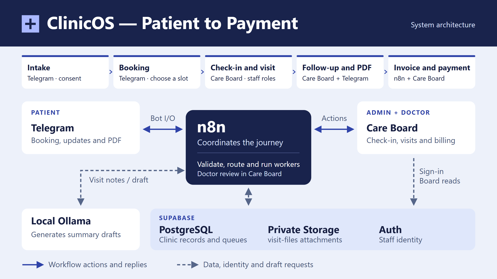
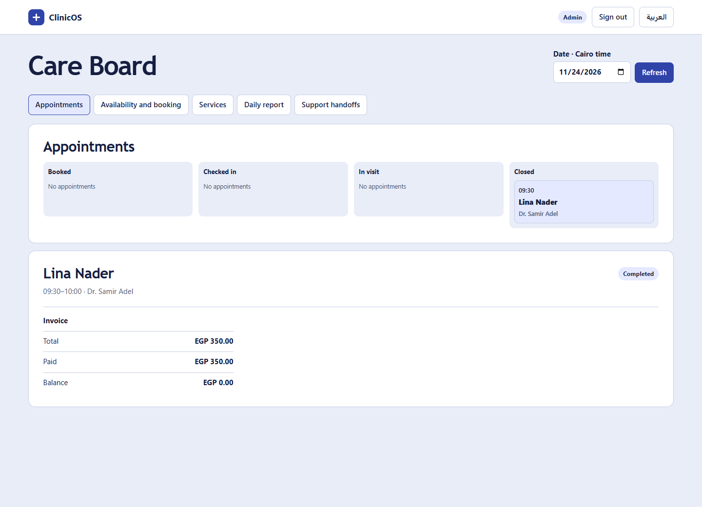

# ClinicOS — Patient to Payment

When booking, visit notes, follow-ups, and billing live in separate places, clinic staff have to piece together the history of each visit. Patients can be left waiting for a confirmation, a follow-up time, or a summary. ClinicOS brings these handoffs into one journey. Patients use Telegram, staff use Care Board, and n8n coordinates the work.

[Watch the 86-second launch film](docs/media/clinicos-launch.mp4) · [Download the architecture SVG](docs/architecture/clinicos-infographic.svg) · [Download the n8n workflow](workflows/clinicos-patient-to-payment.json) · [Care Board screenshots](#care-board-screenshots)



## Who does what

| Role | Journey |
| --- | --- |
| **Patient** | Register or link a profile in Telegram, give consent, and choose an available appointment. Receive booking and follow-up updates and, when the doctor sends one, a visit summary PDF. Ziad Zeineldine’s intake connects to Menna Hamed’s scheduling and Osama Azab’s notifications. |
| **Admin** | Sign in to Care Board, select the clinic date, and check the patient in. After the doctor finalizes the visit, open the generated invoice, record the payment already received, and check the balance. Moustafa Mohamed owns billing and reports. |
| **Doctor** | Open the assigned visit in Care Board, record notes, book a follow-up slot, and review the summary draft. Approve it, print it to PDF, upload it, and confirm the patient and filename before sending it through Telegram. Finalize the visit with the services performed. Salma Hassanien owns the clinical workflow. |

Care Board uses **Supabase Auth** for staff sign-in and reads the board through authenticated Supabase functions. Staff actions and Telegram updates go to **n8n**. **Supabase PostgreSQL** holds the clinical, scheduling and billing records, and the private **`visit-files`** Storage bucket holds attachments. **Local Ollama** drafts from the authorized visit notes. The doctor can edit, approve, or reject the draft in Care Board.

The project aims to make it easier for patients to access the clinic, give staff clearer handoffs, and show where a visit stands from booking through payment.

## Run ClinicOS on your device

You need Git, Docker with Compose, Python 3.10+, Node.js 20+ with npm, PostgreSQL's `psql` client, a fresh Supabase project, and a dedicated Telegram bot for the demo. Install [cloudflared](https://developers.cloudflare.com/tunnel/installation/) for the Telegram callback. Use fictional records.

1. **Clone and start n8n.**

   ```sh
   git clone https://github.com/nhahub/NHA-5-179.git
   cd NHA-5-179
   docker compose up -d
   ```

   Open the n8n editor at `http://localhost:8081` and create its owner login. The Compose volume retains your n8n data across restarts. Start Ollama and download the summary model when you want to test drafting.

   ```sh
   docker compose --profile summary up -d
   docker compose exec ollama ollama pull qwen3:4b-instruct-2507-q4_K_M
   ```

2. **Prepare Supabase.** Apply the included [migrations](supabase/migrations), create the demo accounts, and run the [fictional seed](supabase/seed.sql). Follow [Database and demo accounts](docs/local-setup.md#database-and-demo-accounts) for the exact commands, role passwords, and Auth mappings.

3. **Configure the workflow.** Create credentials in the local n8n editor using the [credential table](docs/local-setup.md#n8n-credentials). Fill in the [local workflow configuration](deploy/workflow-config.example.json) as instructed, then generate a draft with the credentials already mapped. Import that file using **Import from File** on a new canvas.

   ```sh
   python -B deploy/configure-workflow.py .local/workflow-config.json .local/clinicos-import.json
   ```

4. **Start Care Board.** Copy your Supabase project URL and publishable key from its dashboard. Set the values in the terminal that will run the website.

   **PowerShell**

   ```powershell
   $env:CLINICOS_SUPABASE_URL = "https://YOUR_PROJECT.supabase.co"
   $env:CLINICOS_PUBLISHABLE_KEY = "YOUR_PUBLISHABLE_KEY"
   python -B staff/server.py
   ```

   **Bash**

   ```bash
   export CLINICOS_SUPABASE_URL="https://YOUR_PROJECT.supabase.co"
   export CLINICOS_PUBLISHABLE_KEY="YOUR_PUBLISHABLE_KEY"
   python3 -B staff/server.py
   ```

   Open `http://127.0.0.1:8094` and sign in with the demo admin or doctor account. Use separate browser profiles for the two roles.

5. **Publish the workflow and connect Telegram.** Follow [Publish and register the bot](docs/local-setup.md#publish-and-register-the-bot) to set the HTTPS callback and click **Publish** in n8n. Send the bot a private `/start`, then follow the fictional demo below.

## Fictional demo

1. **Book.** In the demo bot, send `/register`, then `/agree` and `/profile`. Follow the prompts to create Lina Nader and confirm the fictional details. Use `/profiles` to find the profile number, then `/book PROFILE` and follow the prompts to book a slot with Dr. Samir Adel.
2. **Check in.** As the admin, open the appointment date in Care Board and check Lina in.
3. **Record the visit.** As the assigned doctor, open Lina’s visit, select **Start visit**, and save a fictional note. Find and book a 10:00 follow-up slot on a later date.
4. **Share the summary.** Generate a draft and review it. Approve it, choose **Print approved summary**, save `visit-summary.pdf`, and upload it to the visit. Confirm the linked recipient and filename when sending to the dedicated demo chat. Finalize the visit with one general consultation.
5. **Record payment.** After the invoice worker issues the fictional **350 EGP** invoice, record a **350 EGP** cash payment as admin. The balance is **0 EGP**.

The film uses the actual Care Board interface with fictional local responses and a reconstructed Telegram conversation. Its numbers are demonstration values.

## Care Board screenshots

The screenshots use the fictional demo.



[View the doctor’s notes, approved summary, and private files](docs/screenshots/care-board-doctor.png)

## Team

| Team member | Ownership |
| --- | --- |
| **Ziad Zeineldine** | Telegram intake, registration, consent, and patient identity linking. The linked profile carries into Menna Hamed’s booking flow. |
| **Menna Hamed** | Doctor availability, booking, rescheduling, cancellation, and wait-list handling. The appointment lifecycle connects to Salma Hassanien’s check-in and visit flow. |
| **Salma Hassanien** | Clinical visits, consultation notes and revisions, patient attachments, and visit finalization. The clinical workflow handles doctor review of drafts from Osama Azab’s AI workflow. |
| **Osama Azab** | Patient notifications, reminders, feedback, support handoffs, and AI summary drafting. The doctor decides what to approve for the patient. |
| **Moustafa Mohamed** | Team lead for integration and delivery. Built Care Board, the staff website, and connected it to the n8n workflow. Owns the service catalog, invoicing, payment recording, and billing reports. Invoicing uses the performed services from Salma Hassanien’s finalized visit. |
